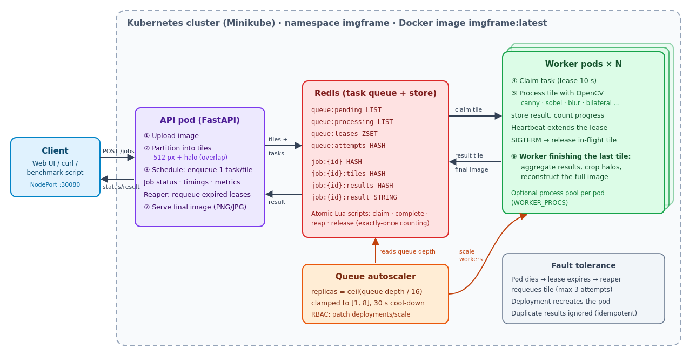

# Cloud-Native Parallel Computing Framework for Scalable Image Processing

BECE355L Advanced Cloud Computing project. Team: Prapti Kurkuri (24BVD0185), Vaanya Garg (24BVD0139), Aditya Manoj (24BVD0077), Arrnav Trisal (24BVD0064).

A large image is split into tiles. The tiles are scheduled through a Redis task queue to parallel worker pods, processed with OpenCV, and stitched back into the final image. The framework scales workers from queue length and recovers automatically when a worker dies.



## Pipeline

| Stage | Where | What happens |
|---|---|---|
| 1. Upload | `api/main.py` `POST /jobs` | The image arrives over HTTP and is decoded with OpenCV |
| 2. Partitioning | `imgframe/tiling.py` | Grid of `TILE_SIZE` tiles. Each carries a halo (overlap) sized for the operation, so the result has no seams |
| 3. Task scheduling | `imgframe/store.py` | Tiles are stored in Redis with one task per tile in `queue:pending` |
| 4. Parallel processing | `worker/main.py` | Workers claim tasks atomically with a lease, run the OpenCV op and store the result. A heartbeat keeps the lease alive |
| 5. Result aggregation | `worker/main.py` `_aggregate` | The worker that completes the last tile collects all results |
| 6. Reconstruction | `imgframe/tiling.py` `reconstruct` | Halos are cropped and the cores stitched into the full image |
| Scaling | `autoscaler/main.py` | `replicas = clamp(ceil(queue_depth / 16), 1, 8)` patches the worker Deployment |
| Fault tolerance | `imgframe/store.py` `_REAP` | Expired leases are requeued (max 3 attempts) and duplicate results ignored |
| Back-pressure | `api/main.py` | HTTP 503 + Retry-After when Redis memory would be exceeded |

Operations: `canny`, `sobel`, `gaussian_blur`, `sharpen`, `grayscale`, `bilateral` (CPU-heavy).

## Run it

See **docs/How_to_Run_and_Demo.docx** for the full step-by-step guide. Quick start:

```bash
cd ~/Downloads/"cloud proj"

# First time after cloning: python3 -m venv .venv && .venv/bin/pip install -r requirements-dev.txt
#   bash scripts/build_redis.sh && .venv/bin/python scripts/make_samples.py

# A. Local, no Docker (uses .tools/bin/redis-server; build it with scripts/build_redis.sh)
.venv/bin/python scripts/run_local.py --workers 4          # open http://127.0.0.1:8000
.venv/bin/python scripts/run_local.py --workers 4 --demo --kill-worker --op bilateral

# B. Docker Compose
docker compose up --build --scale worker=4                 # http://localhost:8000

# C. Kubernetes (Minikube); tools: sudo bash scripts/install_k8s_tools.sh
minikube start --driver=docker --cpus=8 --memory=8g
eval $(minikube docker-env) && docker build -t imgframe:latest .
kubectl apply -f k8s/
kubectl -n imgframe get pods -w                            # UI: http://$(minikube ip):30080
bash scripts/kill_worker.sh k8s &                          # self-healing demo: crash a busy worker...
.venv/bin/python scripts/load_test.py --api http://$(minikube ip):30080 --jobs 6   # ...during a load test
```

## API

| Method | Path | Purpose |
|---|---|---|
| POST | `/jobs` (multipart: `file`, `op`, `tile_size`) | Submit an image |
| GET | `/jobs`, `/jobs/{id}` | Status, progress, per-phase timings |
| GET | `/jobs/{id}/result?format=png\|jpg\|webp&max_side=N` | Final image |
| GET | `/jobs/{id}/preview` | Downscaled upload |
| DELETE | `/jobs/{id}` | Delete a job and free its memory |
| GET | `/metrics` | Queue depth, workers, retries |
| GET | `/docs` | Interactive Swagger UI |

## Tests and benchmarks

```bash
.venv/bin/python -m pytest -v                                   # 26 tests
.venv/bin/python -m benchmark.bench_local --size 8192           # sequential vs 1/2/4/8/16 processes
.venv/bin/python -m benchmark.bench_distributed --workers 1 2 4 8 --op bilateral --size 8192
.venv/bin/python scripts/capture_screenshots.py                 # regenerate report screenshots
.venv/bin/python docs/build_docs.py                             # regenerate report + guide
```

Results are written to `benchmark/results/` (CSV, JSON and charts).

## Layout

```
imgframe/     core: config, ops (OpenCV), tiling, Redis store + reliable queue, pipeline
api/          FastAPI service + web UI (index.html)
worker/       worker process
autoscaler/   queue-length autoscaler for Kubernetes
benchmark/    benchmarks + plots
k8s/          Kubernetes manifests (optional/: HPA and KEDA alternatives)
scripts/      run_local, load_test, kill_worker, install_k8s_tools, build_redis, capture_*
tests/        pytest suite
docs/         report, run/demo guide, screenshots, logs
```

## Configuration (environment variables)

| Variable | Default | Meaning |
|---|---|---|
| `REDIS_URL` | `redis://localhost:6379/0` | Redis connection |
| `TILE_SIZE` | 512 | Default tile edge (px) |
| `LEASE_SECONDS` | 15 | How long a claimed tile may go without a heartbeat |
| `HEARTBEAT_SECONDS` | 3 | Lease renewal interval |
| `MAX_RETRIES` | 3 | Attempts per tile before the job fails |
| `WORKER_PROCS` | 1 | Process-pool slots per worker |
| `OPENCV_THREADS` | 1 | OpenCV internal threads per process |
| `CHAOS_CRASH_RATE` | 0 | Probability a worker crashes mid-tile (fault-injection testing) |
| `RESULT_TTL_SECONDS` | 900 | How long a finished image is kept in Redis |
| `REDIS_MEMORY_BUDGET` | 0.9 | Fraction of Redis maxmemory usable before new jobs get HTTP 503 |
| `MAX_CONCURRENT_UPLOADS` | 2 | Uploads partitioned concurrently (bounds API memory) |
