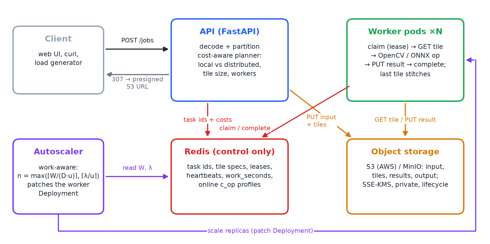
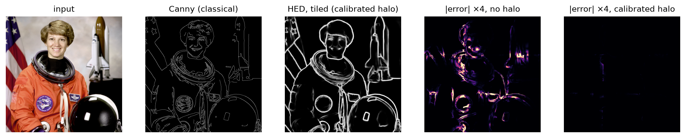
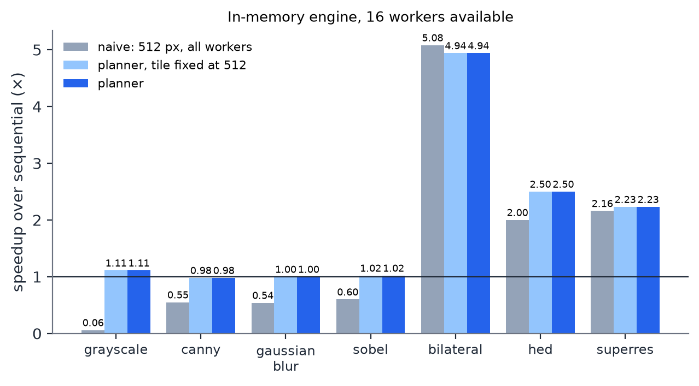
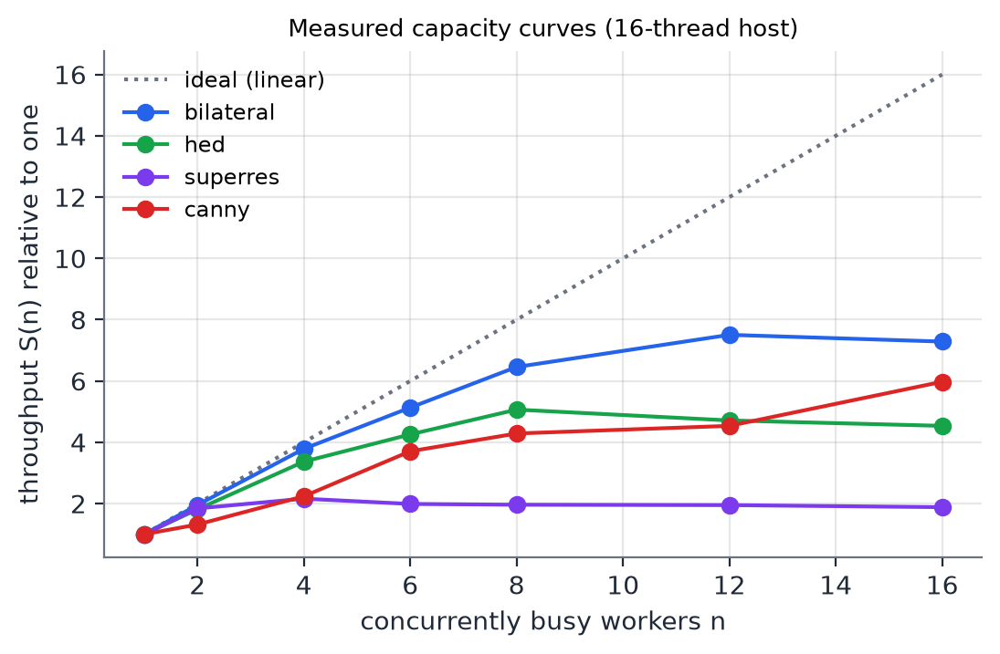
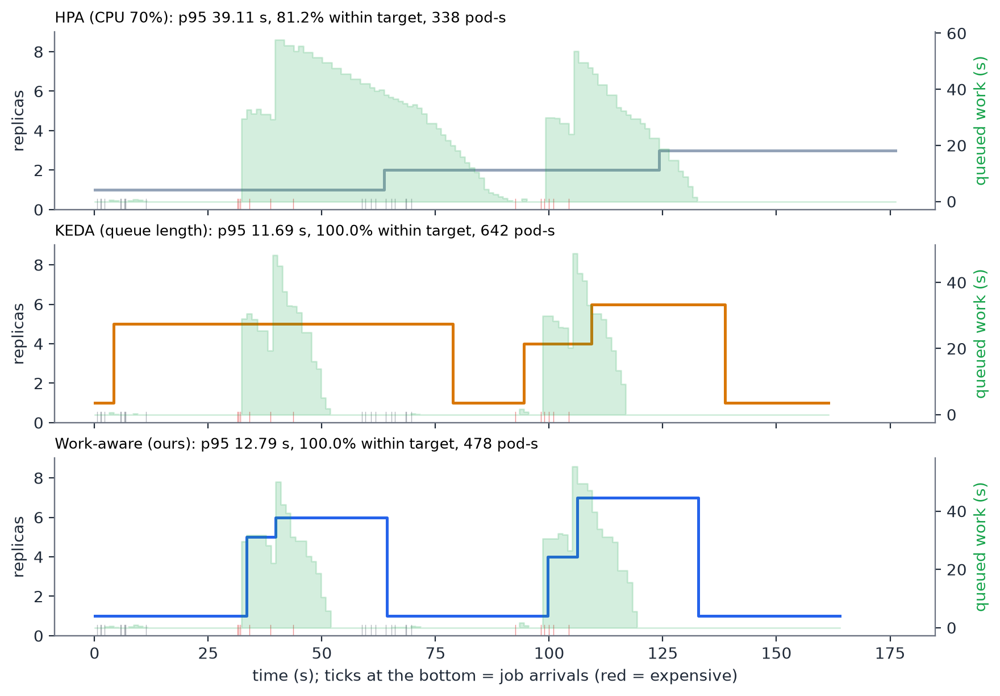

# Cloud-Native Parallel Image Processing

**Split a huge image into tiles, process them on an elastic pool of Kubernetes workers, and stitch them back with no seams. The framework decides for itself whether distributing is worth it, how finely to split, and how many workers to run.**


<p align="center">
  <br>
  <em>Bytes flow through object storage; Redis carries only task IDs, leases and the queued work-seconds that drive autoscaling.</em>
</p>

## Why

A satellite scene or a whole-slide pathology scan can be hundreds of megapixels. Most image filters are local, so the image can be cut into tiles and processed in parallel. Each tile needs a *halo* of overlap, so that the stitched result is identical to processing the whole image. Doing this well on a cloud platform raises four hard questions. This project answers each with an upgrade, measured on real runs:

| Question | Answer in this project | Measured |
|---|---|---|
| Where do the bytes live? | **Object storage** (S3 / MinIO) for inputs, tiles and results; Redis holds only IDs | Redis per 8192² job **226 MB → 0.05 MB**; concurrent 8192² jobs **2 → 12+** |
| Can deep-learning models be tiled without seams? | **HED** edge detection and **Real-ESRGAN ×4** in ONNX Runtime, halos calibrated from the *effective* receptive field | Halo **98 → 80 px** (HED), **34 → 4 px** (ESRGAN), seam PSNR ≥ 40 dB |
| Is distributing even worth it? | A **cost-aware planner** with a calibrated time model picks local vs distributed, tile size and worker count | Prediction error **25 %** (linear model: 40 %); naive grayscale **0.06× → 1.11×** |
| How many workers right now? | A **work-aware autoscaler** that scales on queued compute-seconds, compared with HPA and KEDA | 100 % of jobs within a 30 s target with **25 % fewer** worker pod-seconds than KEDA; HPA met it for only 66 % |

## Results

<p align="center">
  <br>
  <em>Classical Canny vs deep-learning HED on the same photo. The error maps (tiled minus whole-image output) are blank: with the calibrated halo, tiling leaves no seams.</em>
</p>

**The planner removes the slowdowns of naive tiling.** Cutting every job into 512 px tiles makes cheap operations *slower* than one process, because moving a tile costs more than filtering it. The planner predicts this and keeps them local. It also stops adding workers to memory-bound neural models at the point where more workers no longer help.

<p align="center">
  
  
</p>

**Scaling on work instead of queue length.** The same seeded trace was replayed against each autoscaler on Minikube, 3 runs each:

<p align="center">
  
</p>

| Autoscaler | p95 latency | Jobs within 30 s | Worker pod-seconds |
|---|---|---|---|
| HPA (CPU 70 %) | 42.7 ± 3.9 s | 66 % | 328 ± 11 |
| KEDA (queue length) | 14.8 ± 5.9 s | 100 % | 657 ± 28 |
| **Work-aware (ours)** | **12.5 ± 0.2 s** | **100 %** | **490 ± 12** |

<sub>Mean ± std over 3 interleaved runs, 32 jobs (seeded trace), Minikube on 8 CPUs. Dropping to one worker 10 s after the queue empties cut the work-aware scaler from 560 to 490 pod-seconds.</sub>

KEDA counts tiles, so it scales up for bursts of cheap jobs that one worker would finish in two seconds. HPA waits for CPU averages and reacts too late. The work-aware scaler sizes the pool from the compute-seconds actually waiting, and drops back to one worker 10 s after the queue is empty.

## How it works

1. **Upload and plan:** `POST /jobs`. The planner predicts `T = split + ⌈K/n⌉·c·p̄·n/S(n) + overhead + stitch` from a calibrated per-operation cost `c` and a measured capacity curve `S(n)`. It then chooses local vs distributed, the tile size and the worker count.
2. **Partition:** tiles with halos (stride-aligned for HED) are uploaded to the bucket; one task ID per tile is queued in Redis with its predicted cost.
3. **Process:** stateless workers claim tiles under a lease renewed by heartbeats. They run OpenCV or ONNX Runtime and write results back to the bucket. All queue state changes are atomic Lua scripts. A crashed worker's tiles are re-queued, and duplicate results are ignored.
4. **Stitch:** the last finisher crops the halos and assembles the output, scale-aware for ×4 super-resolution. Outputs over 150 MP stream into a tiled BigTIFF.
5. **Deliver:** a 307 redirect to a presigned S3 URL. Result bytes never pass through the API.
6. **Scale:** the autoscaler reads the queued work-seconds `W` and its arrival rate `λ`, and sets `n = max(⌈W/(D·u)⌉, ⌈λ/u⌉)`.

Operations: `grayscale`, `canny`, `sobel`, `gaussian_blur`, `sharpen`, `bilateral`, `hed` (deep edge detection), `superres` (×4).

The REST API (`/jobs`, `/plan`, `/metrics`, presigned results) and the web UI are served by FastAPI. Swagger docs are at `/docs`.

## Documentation

| | |
|---|---|
| [Project report (IEEE)](docs/Project_Report_IEEE.pdf) | Design, every upgrade, all measurements, limitations, 24 references |
| [Slides](docs/Project_Presentation.pptx) | 15-slide overview |
| [How-to-run guidebook](docs/How_to_Run_Guide.pdf) | Set-up, local / Compose / Kubernetes, autoscalers, reproducing every result |

## Repository layout

```
imgframe/     core: ops (OpenCV + ONNX), tiling, Redis store + Lua queue, S3 object store, planner,
              profiles.json (calibrated costs), calibration.json (calibrated halos)
api/          FastAPI service + web UI
worker/       worker process (online cost updates, streamed TIFF output)
autoscaler/   work-aware / queue-length autoscaler
benchmark/    benchmarks and results/ (JSON, CSV, logs)
k8s/          manifests: Redis, MinIO, API, workers, autoscaler; optional/ HPA and KEDA
deploy/aws/   S3 bucket policy, IAM, lifecycle rules, IRSA (templates, not deployed)
scripts/      run_local, model conversion, halo calibration, profiling, trace replay, k8s helpers
tests/        43 pytest tests
docs/         report, slides, guide, figures, screenshots, HOW_TO_RUN.md
```

## Running it

Local (no Docker), Docker Compose or Kubernetes, plus the tests and every benchmark: see **[docs/HOW_TO_RUN.md](docs/HOW_TO_RUN.md)**. The illustrated [guidebook](docs/How_to_Run_Guide.pdf) covers the same steps with screenshots and troubleshooting.

## Limitations

- All measurements come from one 8-core / 16-thread laptop. The neural models are memory-bandwidth bound there and peak at about 2.5×; a multi-node cluster would scale further.
- The AWS templates (S3 with SSE-KMS, least-privilege IAM, IRSA) are complete but were not deployed. MinIO stood in for S3.

## Team

BECE355L Advanced Cloud Computing, VIT Vellore, Fall Semester 2026–27. Faculty: Aparna Mohanty.

| Name | Reg. No. |
|---|---|
| Prapti Kurkuri | 24BVD0185 |
| Vaanya Garg | 24BVD0139 |
| Aditya Manoj | 24BVD0070 |
| Arrnav Trisal | 24BVD0064 |
